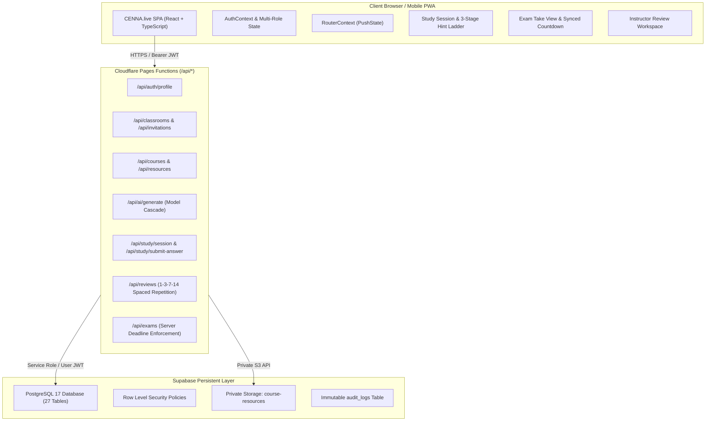

# CENNA.live Technical Architecture Specification

**Version:** 1.0 (Pilot Implementation)  
**Status:** Authoritative  
**Domain:** Active Retrieval & Deliberate Practice Platform  

---

## 1. System Overview & Macro Topography

CENNA.live is architected as a decoupled, edge-first distributed application consisting of:
1. **Frontend Single Page Application (SPA):** Built with React 18, TypeScript, Vite, and Ant Design 5 with a custom responsive design token palette.
2. **Edge API Services:** Hosted on Cloudflare Pages Functions (`functions/api/*`), executing with sub-50ms latency across global edge points of presence.
3. **Authoritative Persistent Database:** Supabase PostgreSQL 17 featuring Row Level Security (RLS) across all 27 domain tables.
4. **Private Storage Buckets:** Private S3-compatible storage (`course-resources`) restricted by IAM and RLS.
5. **Multi-Model AI Extraction Cascade:** Server-side LLM inference with prompt sanitization, Zod schema validation, and deterministic preceptor fallbacks.
6. **Transactional Notification Service:** Resend API integration with database-backed idempotency logs (`email_events`).



---

## 2. Frontend Client Architecture

### 2.1 Component & Routing Topology
The client utilizes a zero-dependency pushState router (`RouterContext`) providing clean URLs, history stack integration, and parameter extraction:
- **Public Routes:** `/`, `/features`, `/how-it-works`, `/privacy`, `/terms`, `/auth/login`, `/auth/register`, `/auth/forgot-password`, `/invite/:token`.
- **Student Experience:**
  - `/app/today`: Daily ~25 minute recommended study target, due reviews counter, and active course resume.
  - `/app/classrooms`: Enrolled classrooms and invite token redemption modal.
  - `/app/courses/:courseId`: Structured course syllabus modules and concept cards.
  - `/app/study/:sessionId`: Active retrieval interface with grounded citations, multi-format questions, 3-stage Socratic hint modal, and real-time mastery recalculation.
  - `/app/review`: Spaced repetition queue (1, 3, 7, 14 days) with lapse status.
  - `/app/exams`: Mock examination listing and historical attempts.
  - `/app/exams/:id/take`: Timed exam environment with server-synced countdown, question palette, flagging, and autosave.
  - `/app/exam-attempts/:id/results`: Diagnostic report with topic performance and direct remediation links.
  - `/app/progress`: Honest mastery distributions, interval stability, and first-attempt accuracy.
- **Instructor Experience:**
  - `/app/teach`: Teaching overview and pending review counter.
  - `/app/teach/classrooms`: Classroom creation and cryptographic invite link generation.
  - `/app/teach/courses`: Curriculum and module authoring.
  - `/app/teach/resources`: Document ingestion, raw text upload, and semantic chunk viewer.
  - `/app/teach/content-review`: Mandatory review gate with side-by-side chunk excerpts and approve/edit/publish workflows.
  - `/app/teach/analytics`: Classroom error rates, at-risk concepts, and misconceptions.
- **Administrator Experience:**
  - `/app/admin/audit`: Immutable security audit log viewer.

### 2.2 Role-Based Persona Switching
Users possessing multiple roles (e.g. `instructor` and `student`) can seamlessly toggle active views via the top navigation bar. Profile and role state are managed centrally in `AuthContext`.

---

## 3. Server Edge Architecture (`functions/api/*`)

All server logic executes in Cloudflare Pages Functions, ensuring privileged credentials (OpenRouter, Supabase service-role key, Resend API key) never touch the client bundle:

1. **`functions/_lib/supabaseServer.ts`**: Provides authenticated Supabase clients:
   - `getAuthenticatedClient(request, env)`: Reads `Authorization: Bearer <token>` and enforces the caller's RLS context.
   - `getServiceRoleClient(env)`: Used solely for privileged administrative and batch operations (e.g., initial user provisioning, logging audit events).
2. **`functions/_lib/spacedReview.ts`**: Implements the mathematical spaced repetition schedule:
   - Stages 1 to 4 correspond to 1, 3, 7, and 14 days.
   - Incurring a retrieval error triggers an immediate lapse reset to Stage 1.
   - Using hints applies attenuation multipliers (0.85 for Stage 1, 0.65 for Stage 2, 0.40 for Stage 3) to the mastery gain.
   - Mastery is strictly clamped between 0 and 100.
3. **`functions/_lib/emailService.ts`**: Manages transactional email delivery via Resend with idempotency tracking in `email_events`.
4. **`functions/_lib/aiService.ts`**: Model cascade that sanitizes inputs against prompt injection, enforces Zod structured output schemas, and falls back to deterministic preceptors on upstream API failures.

---

## 4. Timed Mock Exam Engine & Server Enforcement

The exam engine guarantees academic integrity through server-authoritative timekeeping:
1. **Start Event (`POST /api/exams/:id/start`):**
   - Server computes `deadline_at = NOW() + (duration_minutes * 60 seconds)`.
   - Creates an in-progress record in `exam_attempts`.
   - Returns the authoritative `deadline_at` timestamp to the client.
2. **Intermediate Autosave (`POST /api/exams/attempts/:attemptId/answers`):**
   - Saves current answers every 25 seconds or on question change.
   - Checks `IF NOW() > deadline_at + 30s_grace THEN REJECT`.
3. **Submission Event (`POST /api/exams/attempts/:attemptId/submit`):**
   - Enforces `deadline_at`.
   - Grades all submitted answers against answer keys and numeric tolerances.
   - Aggregates topic performance and marks topics with `<75%` accuracy as `needs_remediation = true`.
   - Updates attempt status to `completed` and records final `score_pct`.

---

## 5. Document Ingestion & Provenance Pipeline

```
  [Uploaded File (PDF / DOCX / TXT)]
                 │
                 ▼
  [Private Bucket: course-resources]
                 │
                 ▼
  [Server Text Extraction & Semantic Chunking]
                 │
                 ▼
  [Table: resource_chunks (page_number, paragraph_index, content)]
                 │
                 ▼
  [AI Concept & Question Extraction]
                 │
                 ▼
  [Status: 'needs_review' (Locked from Students)]
                 │
                 ▼
  [Instructor Content Review Workspace]
    - Approve / Edit & Approve / Reject
                 │
                 ▼
  [Status: 'published' (Active in Student Study Sessions)]
```

---

## 6. Socratic Hint Progression Ladder

To avoid the cognitive trap of premature answer revelation, CENNA.live implements a 3-stage hint ladder:
- **Stage 1 (Orientation):** Identifies the governing scientific principle, law, or equation without numeric values.
- **Stage 2 (Reasoning):** Analyzes relationships between known parameters and identifies misleading distractors.
- **Stage 3 (Application):** Outlines specific mathematical substitution or step-by-step clinical methodology.
- **Answer Disclosure:** Occurs only after answer submission.
- Every hint request is audited in `hint_events` with timestamp, stage, and concept ID.
