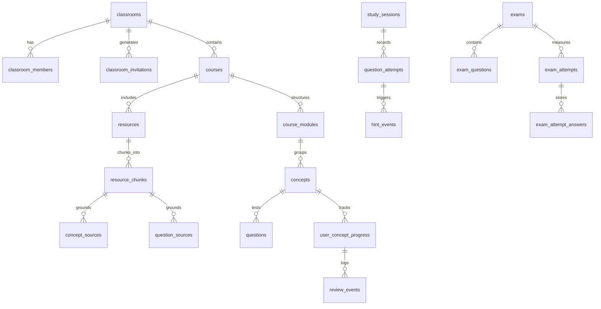

# CENNA.live Database Architecture & Schema Specification

**Engine:** PostgreSQL 17 (Supabase Project `ibyntbynqkpkkpeoudzv`)  
**Security Model:** Full Row Level Security (RLS) across all 27 tables  
**Storage Buckets:** `course-resources` (Private, 50MB limit), `user-avatars` (Private, 5MB limit)  

---

## 1. Relational Entity Inventory

The database contains 27 production tables organized into 8 functional clusters:



---

## 2. Table Schemas by Domain Cluster

### 2.1 Identity & Access Control
- **`user_roles`**: Maps `user_id` (references `auth.users`) to permissions.
  - Columns: `id`, `user_id`, `role` (`student`, `instructor`, `admin`), `created_at`.
  - Constraints: Unique pair `(user_id, role)`.

### 2.2 Academic Organization & Invitations
- **`classrooms`**: Top-level academic cohorts.
  - Columns: `id`, `name`, `description`, `created_by`, `created_at`, `updated_at`.
- **`classroom_members`**: Membership roster with enrolled roles.
  - Columns: `id`, `classroom_id`, `user_id`, `role` (`student`, `instructor`), `joined_at`.
  - Constraints: Unique `(classroom_id, user_id)`.
- **`classroom_invitations`**: Cryptographic tokens for enrollment.
  - Columns: `id`, `classroom_id`, `token_hash` (SHA-256), `max_uses`, `times_used`, `expires_at`, `created_by`, `created_at`.

### 2.3 Curriculum Architecture
- **`courses`**: Course syllabi assigned to classrooms.
  - Columns: `id`, `classroom_id`, `title`, `code`, `description`, `created_by`, `created_at`, `updated_at`.
- **`course_modules`**: Sequential learning units within a course.
  - Columns: `id`, `course_id`, `title`, `description`, `order_index`, `created_at`.

### 2.4 Document Processing & Provenance
- **`resources`**: Uploaded instructional files or texts.
  - Columns: `id`, `course_id`, `title`, `file_path`, `file_type`, `file_size_bytes`, `mime_type`, `processing_status` (`pending`, `processing`, `completed`, `failed`), `raw_text`, `created_by`, `created_at`.
- **`resource_chunks`**: Semantically extracted paragraphs with exact document coordinates.
  - Columns: `id`, `resource_id`, `chunk_index`, `page_number`, `paragraph_index`, `content`, `token_count`, `metadata`, `created_at`.
- **`processing_jobs`**: Background worker queue records for document chunking and indexing.
  - Columns: `id`, `resource_id`, `job_type`, `status`, `error_message`, `started_at`, `completed_at`, `created_at`.

### 2.5 Concepts & Knowledge Graph
- **`concepts`**: Atomic educational topics extracted from course texts.
  - Columns: `id`, `module_id`, `course_id`, `name`, `slug`, `description`, `pillar`, `status` (`draft`, `needs_review`, `approved`, `published`), `created_at`, `updated_at`.
- **`concept_sources`**: Foreign-key coordinates linking concepts to exact `resource_chunks`.
  - Columns: `id`, `concept_id`, `chunk_id`, `relevance_score`, `created_at`.
- **`concept_relations`**: Knowledge graph edges between concepts (e.g. `prerequisite_for`, `related_to`).
  - Columns: `id`, `source_concept_id`, `target_concept_id`, `relationship_type`, `created_at`.

### 2.6 Active Retrieval & Question Bank
- **`questions`**: Active recall items with Socratic hint ladders.
  - Columns: `id`, `concept_id`, `stem`, `question_type` (`single_choice`, `multiple_choice`, `numeric`, `short_answer`), `options` (JSONB array), `correct_answer`, `explanation`, `hint_stage_1`, `hint_stage_2`, `hint_stage_3`, `tolerance_pct`, `status` (`draft`, `needs_review`, `approved`, `published`), `created_by`, `created_at`, `updated_at`.
- **`question_sources`**: Provenance links tying questions to specific `resource_chunks`.
  - Columns: `id`, `question_id`, `chunk_id`, `created_at`.

### 2.7 Study Sessions & Spaced Repetition Progress
- **`study_sessions`**: Time-bounded learning events targeting ~25 minutes.
  - Columns: `id`, `user_id`, `course_id`, `concept_id`, `started_at`, `completed_at`, `target_duration_minutes`, `status`, `created_at`.
- **`question_attempts`**: Individual retrieval question submissions.
  - Columns: `id`, `session_id`, `question_id`, `user_id`, `user_answer`, `is_correct`, `response_time_ms`, `hints_used_count`, `created_at`.
- **`hint_events`**: Audit log of Socratic hint revelations.
  - Columns: `id`, `session_id`, `question_id`, `user_id`, `hint_stage` (1, 2, 3), `created_at`.
- **`user_concept_progress`**: Master spaced repetition record per user-concept pair.
  - Columns: `id`, `user_id`, `concept_id`, `current_interval_days` (1, 3, 7, 14), `current_stage` (0–4), `stability_days`, `mastery_score` (0–100), `lapse_count`, `last_reviewed_at`, `next_review_due_at`, `created_at`, `updated_at`.
  - Constraints: Unique `(user_id, concept_id)`.
- **`review_events`**: History of interval transitions and lapse events.
  - Columns: `id`, `user_id`, `concept_id`, `interval_before`, `interval_after`, `mastery_before`, `mastery_after`, `event_type`, `created_at`.

### 2.8 Mock Examinations & Deadlines
- **`exams`**: Timed mock examination templates.
  - Columns: `id`, `classroom_id`, `course_id`, `title`, `description`, `duration_minutes`, `passing_score_pct`, `max_attempts`, `is_published`, `created_by`, `created_at`.
- **`exam_questions`**: Junction table assigning questions to an exam.
  - Columns: `id`, `exam_id`, `question_id`, `order_index`, `points`.
- **`exam_attempts`**: Individual student exam instances with server-enforced deadlines.
  - Columns: `id`, `exam_id`, `user_id`, `started_at`, `deadline_at`, `submitted_at`, `status` (`in_progress`, `completed`, `timed_out`, `abandoned`), `score_pct`, `topic_diagnostics` (JSONB), `created_at`.
- **`exam_attempt_answers`**: Intermediate and final answers submitted during an exam attempt.
  - Columns: `id`, `attempt_id`, `question_id`, `answer_payload`, `is_correct`, `points_awarded`, `saved_at`.
  - Constraints: Unique `(attempt_id, question_id)`.

### 2.9 Operational Auditing & AI Runs
- **`email_events`**: Idempotency and status log for transactional Resend emails.
  - Columns: `id`, `recipient_email`, `template_name`, `idempotency_key`, `status`, `resend_id`, `created_at`.
- **`audit_logs`**: Immutable security trail for privileged actions.
  - Columns: `id`, `actor_id`, `action`, `target_type`, `target_id`, `ip_address`, `details` (JSONB), `created_at`.
- **`ai_generation_runs`**: Audit record of server-side model inference jobs.
  - Columns: `id`, `resource_id`, `model_name`, `prompt_tokens`, `completion_tokens`, `status`, `error_message`, `created_at`.

---

## 3. Row Level Security (RLS) Policy Design

All 27 tables have RLS enabled with `FORCE ROW LEVEL SECURITY`. Access control is governed by two security definer helper functions:

```sql
CREATE OR REPLACE FUNCTION is_admin(user_uuid UUID)
RETURNS BOOLEAN
LANGUAGE sql
SECURITY DEFINER
SET search_path = public
AS $$
  SELECT EXISTS (
    SELECT 1 FROM user_roles
    WHERE user_id = user_uuid AND role = 'admin'
  );
$$;

CREATE OR REPLACE FUNCTION is_instructor(user_uuid UUID, check_classroom_id UUID DEFAULT NULL)
RETURNS BOOLEAN
LANGUAGE sql
SECURITY DEFINER
SET search_path = public
AS $$
  SELECT EXISTS (
    SELECT 1 FROM user_roles WHERE user_id = user_uuid AND role IN ('instructor', 'admin')
  ) OR (
    check_classroom_id IS NOT NULL AND EXISTS (
      SELECT 1 FROM classroom_members
      WHERE user_id = user_uuid AND classroom_id = check_classroom_id AND role = 'instructor'
    )
  );
$$;
```

### Access Matrix Summary
| Resource | Student Access | Instructor Access | Administrator Access |
|---|---|---|---|
| `classrooms` | SELECT if member | ALL if creator/instructor | ALL |
| `resources` / `chunks` | SELECT if enrolled | ALL if classroom instructor | ALL |
| `concepts` / `questions` | SELECT if `status = 'published'` | ALL in assigned courses | ALL |
| `user_concept_progress` | SELECT / UPDATE own records | SELECT for enrolled classroom | ALL |
| `exam_attempts` | SELECT / UPDATE own in-progress | SELECT for classroom | ALL |
| `audit_logs` | NO ACCESS | NO ACCESS | SELECT |
