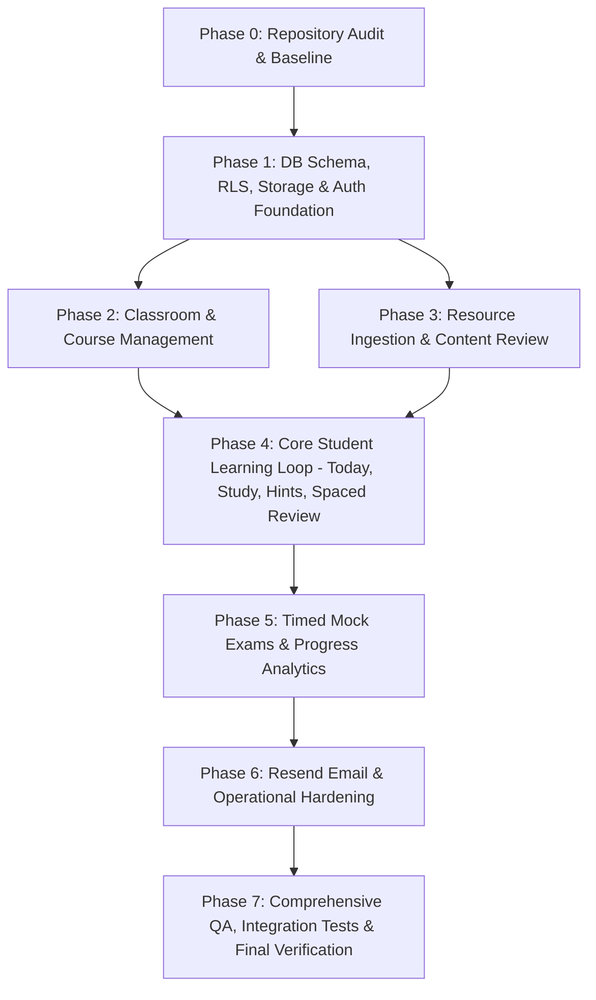

# CENNA.live — Master Autonomous Implementation Plan

**Product:** CENNA.live (v1.0 — Pilot Implementation)  
**Architecture:** Vite + React 18 + TypeScript (Strict) + Supabase (PostgreSQL 17 + Auth + Storage + RLS) + Cloudflare Pages Functions + Resend  
**Date:** 2026-10-09  

---

## 1. Plan Overview & Dependency Ordering

---

## 2. Phase Breakdown

### Phase 0: Repository Audit & Baseline (Completed)
- [x] Inspect package configuration, scripts, dependencies, and environment variables.
- [x] Run baseline build (`npm run build`) and test suite (`npm test`).
- [x] Resolve host disk constraints and confirm 0-error TypeScript checks (`npm run typecheck`).
- [x] Inspect Supabase database via Supabase MCP (`ibyntbynqkpkkpeoudzv`).
- [x] Create `docs/REPOSITORY_AUDIT.md` and `docs/IMPLEMENTATION_PLAN.md`.

### Phase 1: Infrastructure & Security Foundation
- [ ] Create Supabase migration `002_cennalive_core.sql` adding:
  - `user_roles` (role-based access control: student, instructor, admin)
  - `classroom_invitations` (token_hash, expires_at, max_uses, use_count, atomic redemption)
  - `course_modules` (module ordering, titles, objectives)
  - `study_sessions` & `question_attempts` & `hint_events`
  - `user_concept_progress` (review_stage, mastery_score 0-100, last_reviewed_at, next_review_at)
  - `review_events` (audit log of spaced repetition state changes)
  - `exams`, `exam_questions`, `exam_attempts`, `exam_attempt_answers`
  - `email_events`, `audit_logs`, `ai_generation_runs`
  - Storage buckets `course-resources` (private) and `user-avatars` with RLS policies.
- [ ] Apply migration via Supabase MCP `apply_migration`.
- [ ] Regenerate TypeScript definitions (`src/types/database.types.ts`).
- [ ] Establish Cloudflare server function architecture:
  - `functions/api/auth/*`
  - `functions/api/classrooms/*`
  - `functions/api/resources/*`
  - `functions/api/study/*`
  - `functions/api/exams/*`
  - `functions/api/email/*`

### Phase 2: Classroom & Course Management
- [ ] Implement instructor classroom creation, editing, and archiving.
- [ ] Implement secure invitation generation (cryptographic tokens, expiration, usage limits).
- [ ] Implement invitation redemption flow (`/invite/:token`) with server validation.
- [ ] Implement course and module authoring for instructors.
- [ ] Implement classroom course association and student enrollment views.

### Phase 3: Resource Ingestion & Content Review Pipeline
- [ ] Implement private file upload to `course-resources` storage bucket.
- [ ] Implement server-side text extraction & chunking with source provenance (page numbers, section headings, chunk indices).
- [ ] Implement AI content generation service (concept summaries, questions, 3-stage hint ladders, citations).
- [ ] Implement instructor review workspace (`/app/teach/content-review`):
  - Draft, Needs Review, Approved, Published, Rejected states.
  - Side-by-side source chunk citation inspection.
  - Explicit approval gate before student visibility.

### Phase 4: Core Student Learning Loop
- [ ] Build the **Today Screen** (`/app/today`):
  - Daily recommended study plan (target ~25 minutes).
  - Due review queue (1, 3, 7, 14 days).
  - Next recommended concept activity.
- [ ] Build **Active Learning Session** (`/app/study/:sessionId`):
  - Concept explanation and grounded excerpts.
  - Question answering: single-choice, multi-select, short-answer, true/false.
  - Socratic progressive hint ladder: Hint 1 (Orientation), Hint 2 (Reasoning), Hint 3 (Clue/Elimination), Explanation (Resolution).
  - Real-time feedback with source citations.
  - Resumable session state on browser refresh.
- [ ] Implement **Spaced Review Engine**:
  - Transparent mastery calculation (0–100 score).
  - Automatic interval progression: 1d -> 3d -> 7d -> 14d on success; immediate remediation on failure.
  - Review queue management (`/app/review`).

### Phase 5: Timed Mock Exams & Progress Analytics
- [ ] Build **Mock Exam Authoring** for instructors (`/app/teach/exams`):
  - Duration, question selection from published question bank, scoring configuration.
- [ ] Build **Timed Exam Taking Engine** (`/app/exams/:examId/take`):
  - Server-authoritative start time and deadline enforcement.
  - Client countdown timer, question navigator, mark for review.
  - Periodic intermediate answer persistence.
  - Auto-submission on deadline expiration.
- [ ] Build **Exam Results & Remediation** (`/app/exam-attempts/:attemptId/results`):
  - Topic-level breakdown, questions requiring remediation, direct link to review queue.
- [ ] Build **Analytics Dashboards**:
  - Student progress analytics (`/app/progress`).
  - Classroom instructor analytics (`/app/teach/analytics`) with privacy-preserving aggregates.

### Phase 6: Resend Email Integration & Operational Hardening
- [ ] Create centralized transactional email service in `functions/api/email/service.ts`:
  - Classroom invitation emails with one-click join links.
  - Study review reminders (opt-in).
  - Idempotency tracking via `email_events` table to prevent duplicate delivery.
- [ ] Implement rate limiting on sensitive API endpoints.
- [ ] Implement account deletion workflow (data scrubbing, private object cleanup).
- [ ] Publish authoritative `/privacy`, `/terms`, `/how-it-works`, `/features` pages.

### Phase 7: Comprehensive QA, Integration Tests & Final Verification
- [ ] Unit tests for all scoring, scheduling, and validation logic.
- [ ] Integration and E2E test scenarios A through G:
  - Scenario A: Student onboarding and Today view.
  - Scenario B: Classroom invitation and enrollment isolation.
  - Scenario C: Document upload, chunking, and instructor review.
  - Scenario D: Active study session, hint progression, and session recovery.
  - Scenario E: Timed mock exam lifecycle and deadline enforcement.
  - Scenario F: Email sending, idempotency, and error handling.
  - Scenario G: Authorization and RLS cross-tenant isolation.
- [ ] Complete documentation suite (`README.md`, `ARCHITECTURE.md`, `DATABASE.md`, `SECURITY.md`, `DEPLOYMENT.md`, `API.md`, `TESTING.md`, `AI_CONTENT_POLICY.md`).
